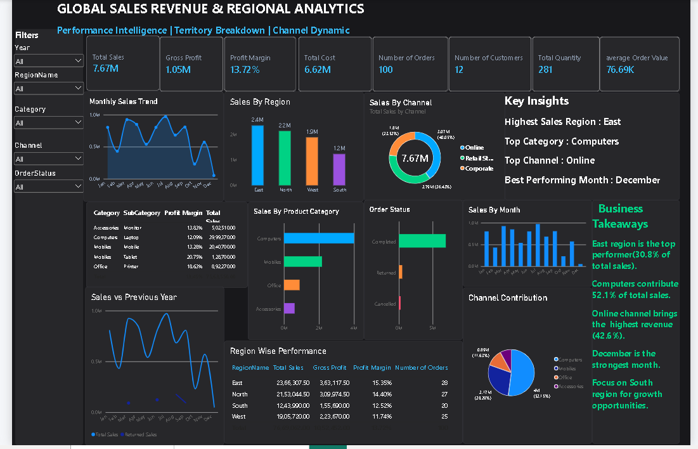

# 📊 Global Sales Revenue & Regional Analytics (Power BI)

## 🚀 Project Overview
This Power BI dashboard is built on a multi-table relational dataset (`Sales`, `Customers`, `Products`, `Regions`). The main objective is to deeply analyze global revenue performance, regional breakdowns, category distribution, and channel dynamics.

## 🛠️ Tools & Technologies Used
* **Power BI Desktop:** Advanced data modeling, relationships, DAX measures, and interactive dashboard design.
* **Excel / Power Query:** Multi-sheet data cleaning and transformation.

## 📌 Key Performance Indicators (KPIs)
* **Total Sales:** $7.67M
* **Gross Profit:** $1.05M
* **Profit Margin:** 13.72%
* **Total Cost:** $6.62M
* **Number of Orders:** 100
* **Number of Customers:** 12
* **Total Quantity Sold:** 281

## 📈 Dashboard Sections & Key Visuals
1. **Performance Intelligence:** Top-level KPIs and financial health indicators.
2. **Territory Breakdown & Regional Performance:** Region-wise sales, gross profit, and profit margin comparison (East region leading with 30.8% total sales).
3. **Category & Product Analysis:** Product category contributions (Computers dominating at 52.1% of total sales).
4. **Channel Dynamics:** Online, Retail Store, and Corporate channel performance tracking (Online channel generating the highest revenue at 42.6%).

## 🖼️ Dashboard Screenshots

## 💡 Business Takeaways & Insights
* **East Region** is the top-performing territory.
* **Computers** product category contributes the highest revenue.
* **Online channel** serves as the primary revenue driver.
* **December** is recorded as the strongest sales month.
